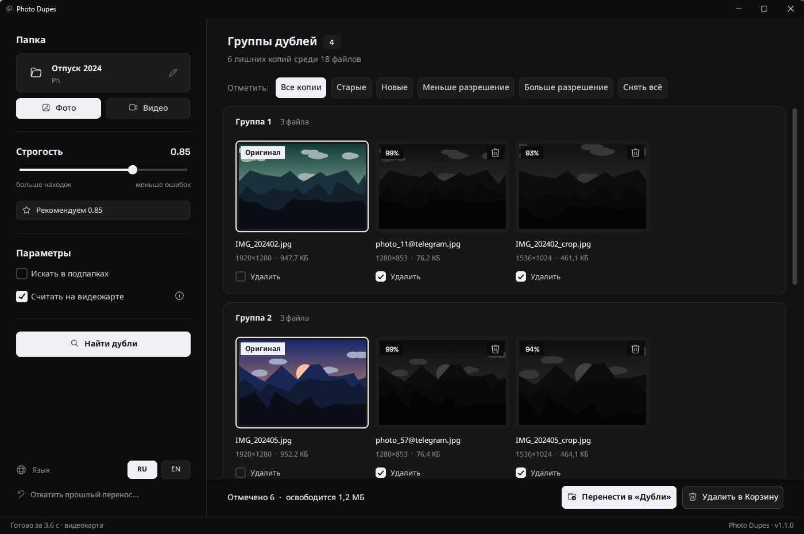
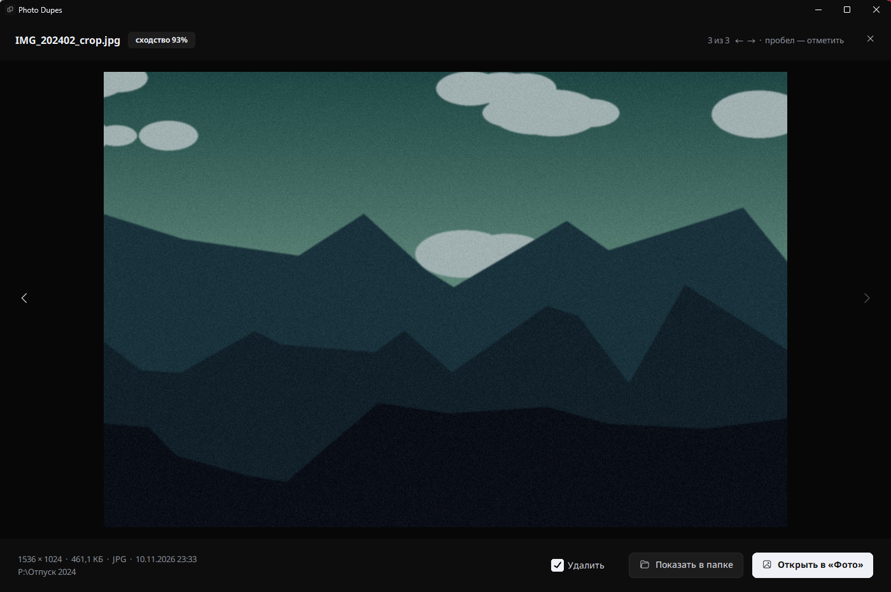

# Photo Dupes

Десктопная программа для Windows, которая ищет дубли среди фото, скриншотов и видео.



## О проекте

Делал для себя: в папке со скриншотами скопились тысячи файлов, и одни и те же картинки лежали там по 3–4 раза — с рамкой, обрезанные, пересжатые после мессенджера. Обычные поисковики дублей сравнивают хэши и такие копии не видят, либо на максимальной чувствительности путают совсем разные картинки. Здесь сравнение делает нейросеть, которую Meta обучала именно искать копии изображений, поэтому кроп и рамки ей не мешают.

## ⬇️ Скачать

Python и что-либо ещё ставить не нужно.

1. Открой страницу **[Releases](https://github.com/krooasan/photo-dupes-finder/releases)** (справа на главной странице репозитория, блок «Releases»).
2. В самой верхней версии раскрой **Assets** и нажми **`PhotoDupesFinder-win64.zip`** (~150 МБ).
3. Открой папку «Загрузки», нажми на архив правой кнопкой → **Извлечь всё…** → **Извлечь**.
   Из самого архива программа не запустится — его обязательно нужно распаковать.
4. В распакованной папке открой `PhotoDupesFinder` и дважды щёлкни **`PhotoDupesFinder.exe`**.
5. Если Windows покажет синее окно **«Система Windows защитила ваш компьютер»** — это нормально: программа не подписана платным сертификатом. Нажми **«Подробнее»** → **«Выполнить в любом случае»**. Это нужно один раз.
6. Нажми **«Выбрать папку и начать»** или просто перетащи папку с фото в окно.

Удобно: правой кнопкой по `PhotoDupesFinder.exe` → **Отправить → Рабочий стол (создать ярлык)**. Сам exe из папки не вынимай, ему нужны файлы рядом.

## Что умеет

- находит копии одного снимка: скриншоты с рамками и чёрными полосами, обрезки, пересжатые копии из мессенджеров;
- находит копии видео (пересжатые, уменьшенные, обрезанные по времени);
- показывает группы с превью и открывает фото на весь экран прямо в программе;
- сам выбирает оригинал: без рамок и полос, с бо́льшим разрешением, не PNG;
- в одно нажатие отмечает «оставить самый новый / старый / с большим или меньшим разрешением»;
- переносит лишнее в папку `Дубли` (можно откатить) или удаляет в Корзину;
- папку можно просто перетащить в окно;
- запоминает результат: повторный поиск по той же папке — секунды;
- считает на любой видеокарте (NVIDIA / AMD / Intel), а без неё — на процессоре;
- интерфейс на русском и английском.

Ничего не удаляется без подтверждения.



## Используемые технологии

- **Python 3.11**
- **[SSCD](https://github.com/facebookresearch/sscd-copy-detection)** (Meta) — нейросеть, которая превращает картинку в вектор из 512 чисел; у копий векторы почти совпадают;
- **ONNX Runtime + DirectML** — запуск модели на любой видеокарте под Windows, без CUDA и PyTorch;
- **NumPy** — сравнение векторов и сборка групп;
- **Pillow, pillow-heif** — чтение фото, включая HEIC с айфона;
- **OpenCV** — кадры из видео;
- **CustomTkinter** — интерфейс; **windnd** — перетаскивание папки в окно;
- **Send2Trash** — удаление в Корзину, а не насовсем;
- **PyInstaller** и **GitHub Actions** — сборка exe и релизы.

## Как запустить

Нужен Python 3.11 на Windows.

```bat
git clone https://github.com/krooasan/photo-dupes-finder.git
cd photo-dupes-finder

py -3.11 -m venv .venv
.venv\Scripts\activate
pip install -r requirements.txt
```

Модель в репозиторий не кладу (98 МБ), её надо один раз скачать и сконвертировать. Для этого временно нужен PyTorch:

```bat
pip install torch onnx onnxruntime
python tools\export_onnx.py
```

Скрипт скачает модель [SSCD](https://github.com/facebookresearch/sscd-copy-detection) от Meta, сохранит `models\sscd_disc_mixup.onnx` и проверит, что ONNX выдаёт то же самое, что оригинал. После этого torch можно удалить.

Запуск:

```bat
python run_app.py
```

Сборка exe (появится в `dist\PhotoDupesFinder\`, рядом zip-архив):

```bat
build.bat
```

## TODO

- [x] скриншоты интерфейса в README
- [x] поддержка видео
- [x] перетаскивание папки в окно
- [ ] тесты для `core.py` (pytest: группировка, выбор оригинала, перенос и откат на маленьких сгенерированных картинках)
- [ ] поддержка RAW (CR2, NEF, ARW, DNG)
- [ ] сравнение с Czkawka и dupeGuru на одной папке, с цифрами
- [ ] навигация с клавиатуры: стрелки по группам, пробел — отметить
- [ ] сборка под Linux / macOS (сейчас только Windows из-за DirectML)

## Лицензия

MIT. Модель SSCD — © Meta Platforms, Inc., MIT. Шрифты Noto Sans и Space Grotesk — SIL Open Font License 1.1.
